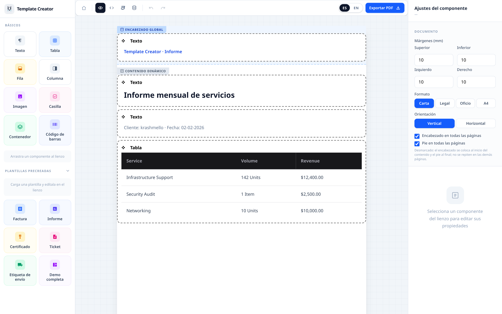
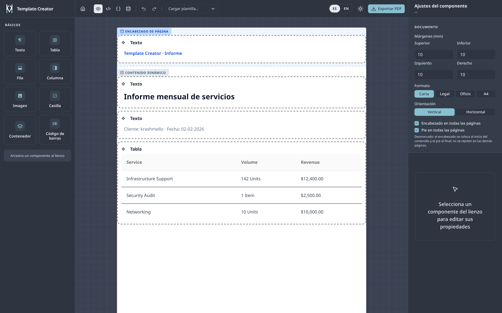
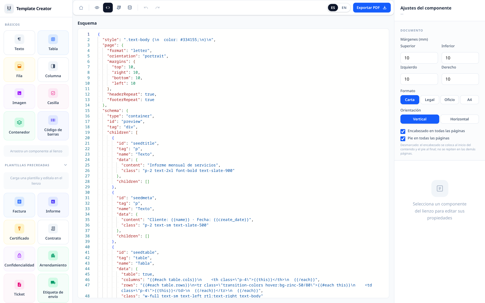
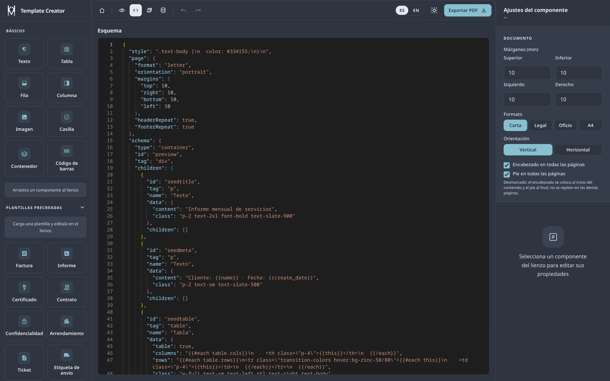
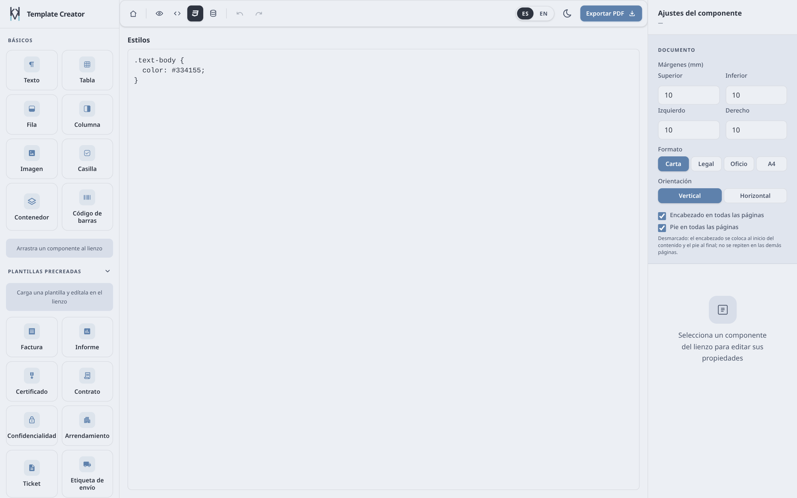
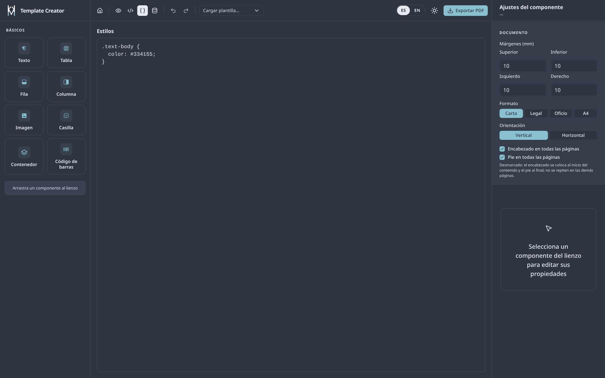
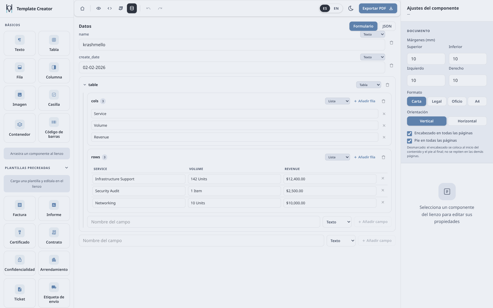
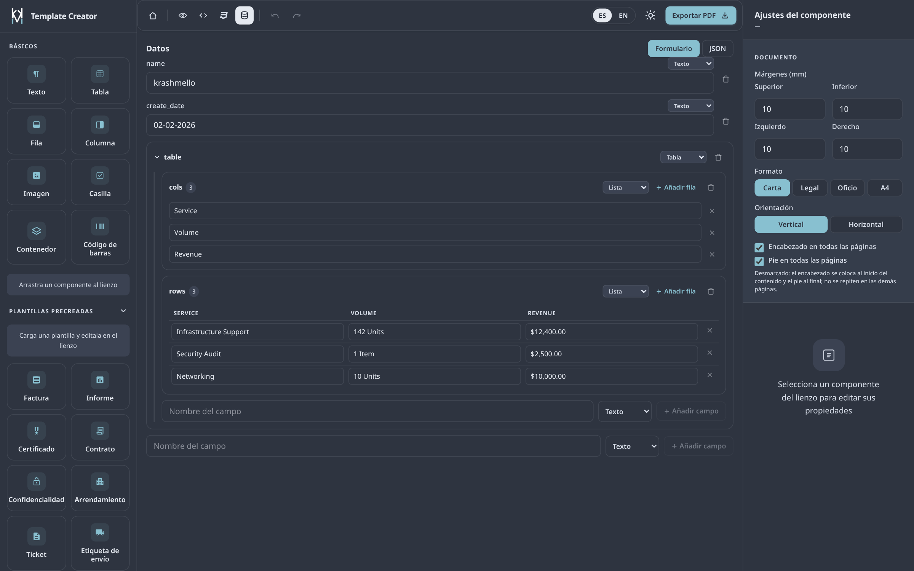

# Template Creator

[Español](README.md) · **English**

Visual PDF template builder: drag components, bind dynamic data, and export the document in one click. No account or install needed to try it — the demo lives at `/demo`.

Stack: Nuxt 4 (SSR) · Tailwind 4 · Nuxt UI 4 · Pinia · Handlebars · Monaco · Puppeteer (`puppeteer-core` + `@sparticuz/chromium`).

## What it does

- **8 draggable components**: text, table, row, column, image, checkbox, container, and barcode.
- **9 ready-made templates**: invoice, report, certificate, contract, NDA, rental, receipt, shipping label, and a full showcase.
- **Three independent zones**: header, body, and footer, each able to repeat on every PDF page.
- **Dynamic data** with Handlebars (`{{customer.name}}`, `{{#each rows}}`), edited as a typed form or raw JSON.
- **Per-document CSS** with live preview.
- **PDF export** in Letter, Legal, Oficio, and A4, portrait or landscape, with millimetre margins.
- **Spanish and English**, light and dark themes, and a session that persists for 24 h.

## Screenshots

| View | Light | Dark |
| --- | --- | --- |
| Preview |  |  |
| JSON schema |  |  |
| CSS styles |  |  |
| Data |  |  |

## Requirements

- **Node** `^22.22.3 || ^24.15.0 || >=26` (required by Nuxt 4.6 and `@sparticuz/chromium`; PDF export fails on Node 20).
- **pnpm** `10.18.3` (the `package.json` `packageManager` field). `pnpm-lock.yaml` is committed: Vercel detects pnpm from it.

## Running locally

```bash
pnpm install
pnpm dev      # http://localhost:3000  → landing at /, editor at /demo
```

Other commands:

| Command | What it does |
| --- | --- |
| `pnpm build` | Production build with the Vercel preset into `.vercel/output`. It is the only check in the project: there are no tests, linter, or typecheck. |
| `pnpm preview` | Serves the production build. |
| `pnpm generate` | Static generation. |
| `pnpm screenshots` | Regenerates the images in `public/screenshots/`. **Requires `pnpm dev` running.** |
| `pnpm check:url-guard` | Verifies the PDF endpoint's SSRF filter. |
| `pnpm check:classes` | Verifies the generated table classes. |

## Configuration

| Variable | Purpose |
| --- | --- |
| `NUXT_PUBLIC_BASE_URL` | Public site URL (used by i18n for absolute links and exposed at runtime as `baseUrl`). |
| `VERCEL_URL` | Automatic fallback on Vercel when the above is unset. |
| `API_BASE_URL` | Configurable API prefix; defaults to `/api`. |

There is no database and no authentication. The locale is stored in the `tc_locale` cookie and the document in `sessionStorage` (24 h).

## Deploying to Vercel

1. Import the repository into Vercel. The `vercel` preset is already set in `nuxt.config.ts` and the output goes to `.vercel/output`.
2. Build with **Node 22 or newer** (Vercel → Settings → Node.js Version). If the build runs on an older version, `@sparticuz/chromium` will not start and `/api/pdf` fails.
3. Set `NUXT_PUBLIC_BASE_URL` to the final domain.
4. `/api/pdf` needs the Node function (not Edge) and Chromium downloaded into `/tmp`; the first export after a cold start is slower.

## Export API

`POST /api/pdf` takes pre-rendered HTML and returns the PDF.

```json
{
  "html": "<h1>Hello</h1>",
  "header": "",
  "footer": "",
  "css": "",
  "page": {
    "format": "letter",
    "orientation": "portrait",
    "margins": { "top": 10, "right": 10, "bottom": 10, "left": 10 },
    "headerRepeat": true,
    "footerRepeat": true
  }
}
```

- Formats: `letter`, `legal`, `a4`; `oficio` (216 × 330 mm) is sent with explicit dimensions.
- Limits: 1 MB of HTML, 200 kB per zone and of CSS, 20 requests per minute per IP, and 3 concurrent renders (503 above that). Puppeteer timeout: 20 s.
- Security: blocks requests to private addresses (SSRF), rejects cross-site requests, and does not accept invalid certificates. Remote assets must be public (`http`/`https`).
- The endpoint is **public and unauthenticated**: those limits damp abuse, they are not access control. If your documents are sensitive, put authentication or Vercel Firewall in front.

## Usage guide

1. Open `/demo`.
2. Optional: load a **prebuilt template** from the top bar. It replaces body, header, footer, and data, and only the body can be undone.
3. Drag components from the left palette onto the canvas, or select a node to edit it in the right panel.
4. Set the **Document**: format, orientation, margins, and whether the header and footer repeat on every page.
5. Fill in **Data** (Data tab) as a form or JSON, and reference it in content with `{{field}}`.
6. Fine-tune the design in the **CSS styles** tab or with per-component classes.
7. Check the **Preview** and hit **Export PDF**.

Good to know:

- **Zones**: header and footer are independent from the body. When "on every page" is unchecked, the header sits at the start of the content and the footer at the end, reserving no space on later pages.
- **Handlebars** runs once: data values are never re-compiled, so do not nest `{{...}}` inside them. In the barcode, content is either literal text or one full expression (never a data key named `barcode`).
- **Barcode**: it produces Code 39, not EAN or QR.
- **Images**: added by file or public URL; private URLs are blocked during rendering.
- **Undo/Redo** covers the body only. Header, footer, data, and page settings are not part of the history.
- **Persistence**: the document is stored in the browser session for 24 h. After a reload you must re-select the component; the selection is not kept.
- **Locale and theme** are switched from the site header or the editor toolbar.

## Privacy

The document is composed in your browser and only leaves it as HTML when you press Export PDF, at which point it is sent to `/api/pdf` for rendering. Nothing is stored on the server. Even so, the endpoint is public: don't use it with confidential documents until authentication is in front of it.

## Project layout

```
app/          pages, components, stores, palette, and templates
server/       /api/pdf plus Puppeteer and URL utilities
i18n/         es/en locales
scripts/      screenshots and checks
public/       logos and screenshots
```

For internal architecture and code conventions, see [`AGENTS.md`](AGENTS.md).

## License

MIT © KrashMello.
