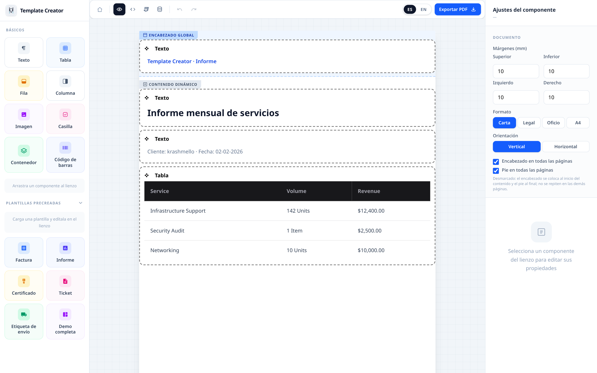
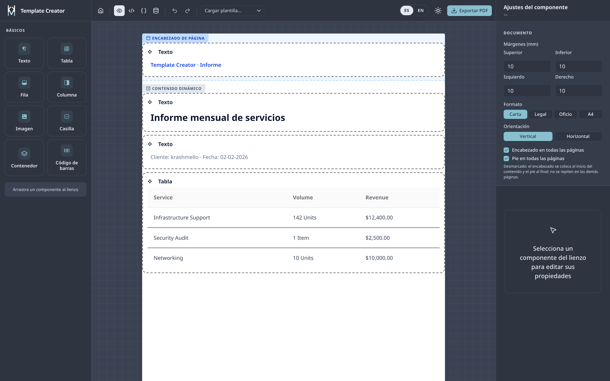
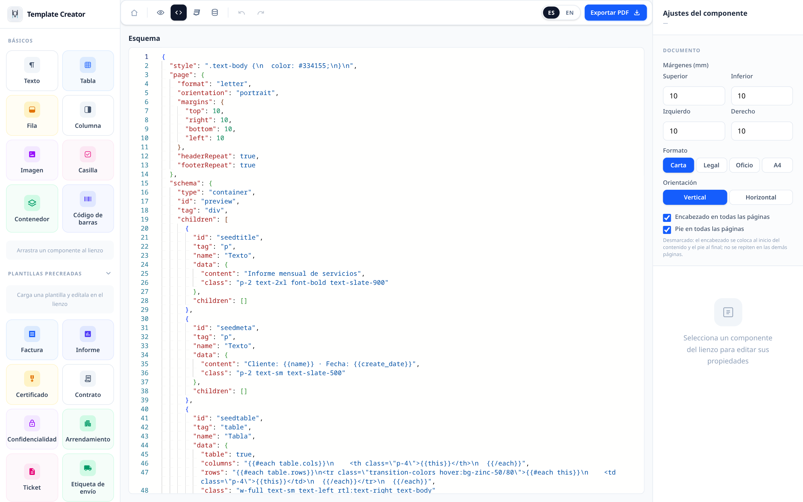
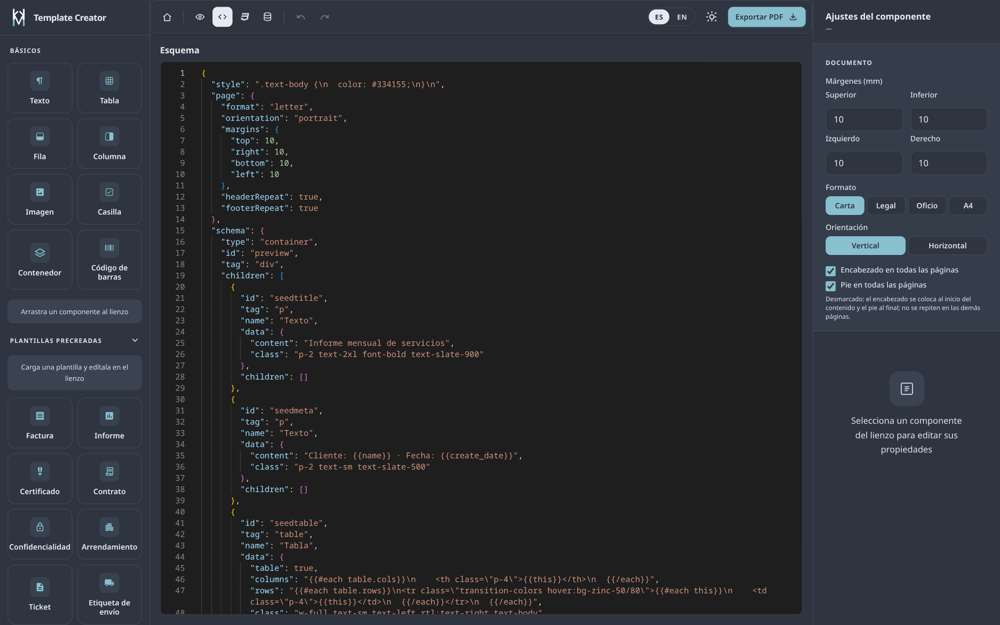
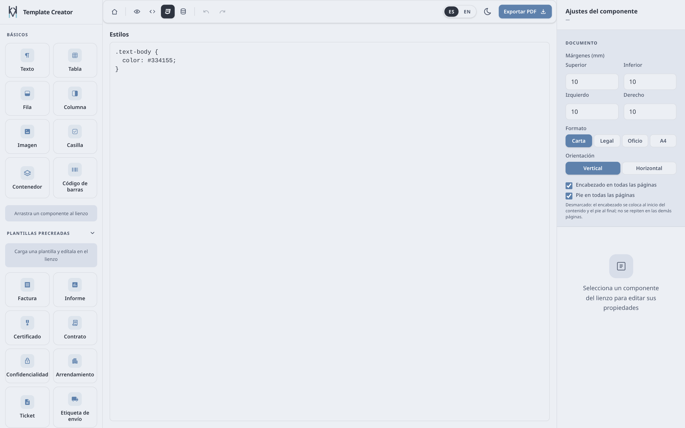
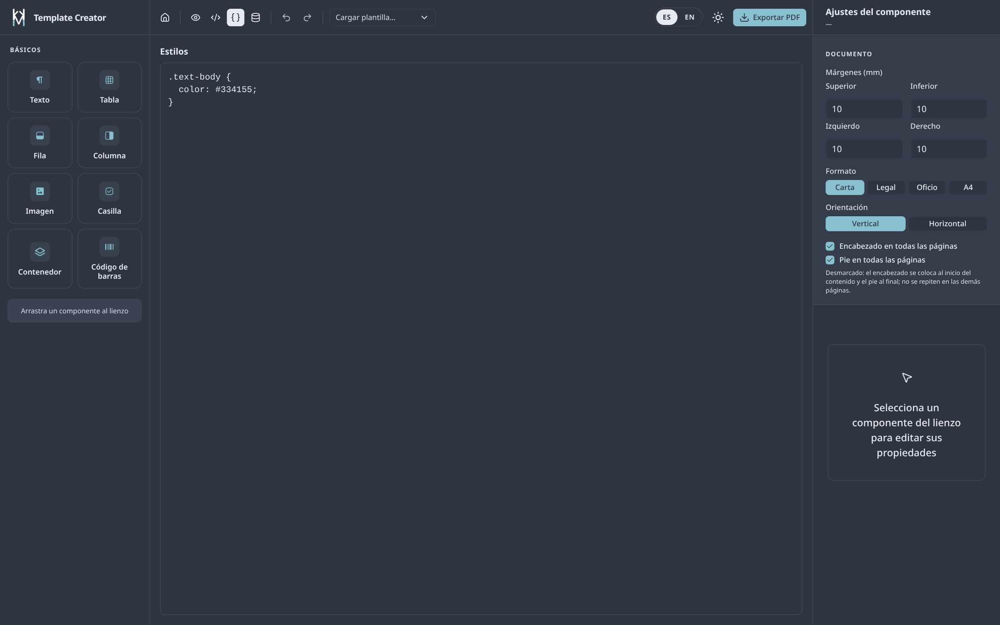
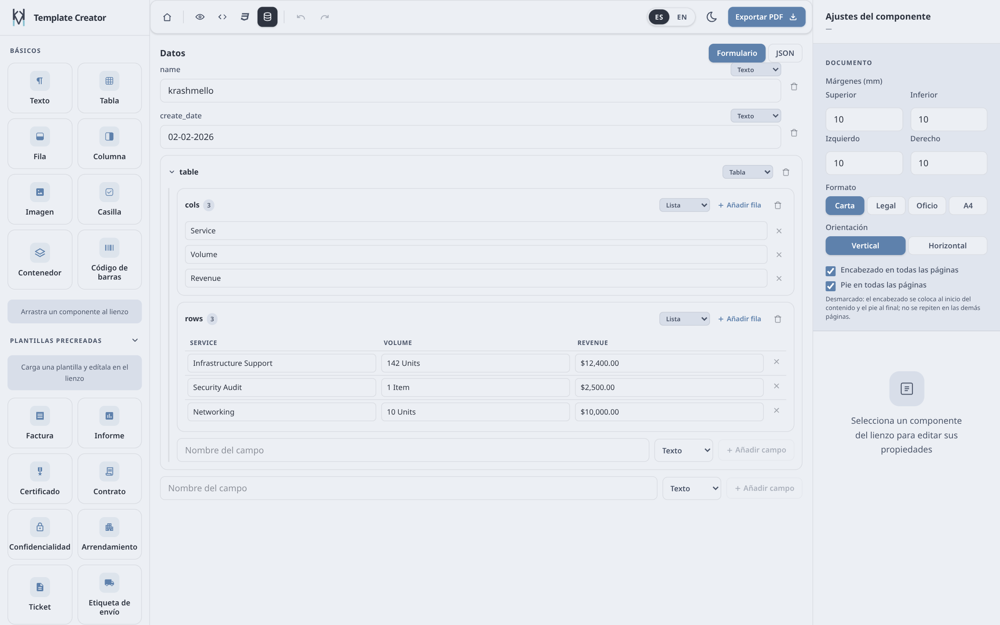
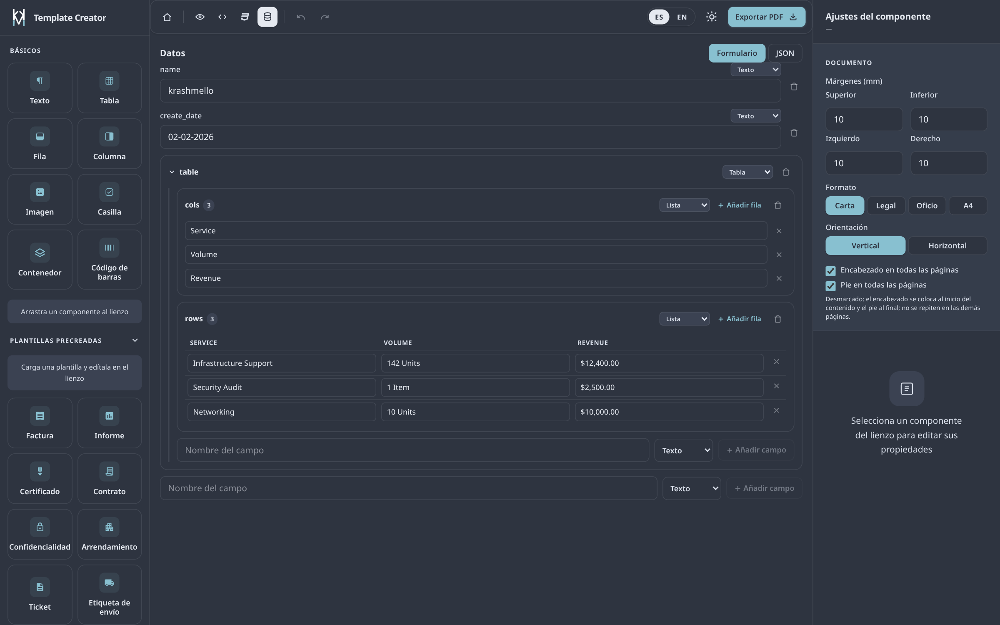

# Template Creator

**Español** · [English](README.en.md)

Constructor visual de plantillas PDF: arrastra componentes, enlaza datos dinámicos y exporta el documento en un clic. Sin cuenta ni instalación para probarlo: la demo vive en `/demo`.

Stack: Nuxt 4 (SSR) · Tailwind 4 · Nuxt UI 4 · Pinia · Handlebars · Monaco · Puppeteer (`puppeteer-core` + `@sparticuz/chromium`).

## Qué incluye

- **8 componentes** arrastrables: texto, tabla, fila, columna, imagen, casilla, contenedor y código de barras.
- **9 plantillas** listas: factura, informe, certificado, contrato, NDA, arrendamiento, ticket, etiqueta de envío y demo completa.
- **Tres zonas** independientes: encabezado, cuerpo y pie, que pueden repetirse en todas las páginas del PDF.
- **Datos dinámicos** con Handlebars (`{{cliente.nombre}}`, `{{#each filas}}`) editables como formulario o JSON.
- **Estilos propios** por documento mediante CSS, con vista previa en vivo.
- **Exportación a PDF** en carta, legal, oficio y A4, vertical u horizontal, con márgenes en milímetros.
- **Español e inglés**, tema claro y oscuro, y persistencia de la sesión durante 24 h.

## Capturas

| Vista | Claro | Oscuro |
| --- | --- | --- |
| Vista previa |  |  |
| Esquema JSON |  |  |
| Estilos CSS |  |  |
| Datos |  |  |

## Requisitos

- **Node** `^22.22.3 || ^24.15.0 || >=26` (lo exigen Nuxt 4.6 y `@sparticuz/chromium`; con Node 20 el PDF no arranca).
- **pnpm** `10.18.3` (`packageManager` del `package.json`). El `pnpm-lock.yaml` está versionado: Vercel detecta pnpm por él.

## Levantamiento local

```bash
pnpm install
pnpm dev      # http://localhost:3000  → landing en /, editor en /demo
```

Otros comandos:

| Comando | Qué hace |
| --- | --- |
| `pnpm build` | Build de producción con preset de Vercel en `.vercel/output`. Es la única verificación del proyecto: no hay tests, linter ni typecheck. |
| `pnpm preview` | Sirve el build de producción. |
| `pnpm generate` | Generación estática. |
| `pnpm screenshots` | Regenera las capturas de `public/screenshots/`. **Requiere `pnpm dev` corriendo.** |
| `pnpm check:url-guard` | Verifica el filtro SSRF del endpoint de PDF. |
| `pnpm check:classes` | Verifica las clases de las tablas generadas. |

## Configuración

| Variable | Para qué |
| --- | --- |
| `NUXT_PUBLIC_BASE_URL` | URL pública del sitio (la usa i18n para enlaces absolutos y la expone el runtime como `baseUrl`). |
| `VERCEL_URL` | Alternativa automática en Vercel cuando no defines la anterior. |
| `API_BASE_URL` | Prefijo de API configurable; por defecto `/api`. |

No hay base de datos ni autenticación. El idioma se guarda en la cookie `tc_locale` y el documento en `sessionStorage` (24 h).

## Despliegue en Vercel

1. Importa el repositorio en Vercel. El preset `vercel` ya está en `nuxt.config.ts` y la salida queda en `.vercel/output`.
2. Construye con **Node 22 o superior** (Vercel → Settings → Node.js Version). Si el build corre en una versión menor, `@sparticuz/chromium` no arranca y `/api/pdf` falla.
3. Define `NUXT_PUBLIC_BASE_URL` con el dominio final.
4. El endpoint `/api/pdf` necesita la función Node (no Edge) y Chromium descargado en `/tmp`; la primera exportación tras un arranque en frío es más lenta.

## API de exportación

`POST /api/pdf` recibe el HTML ya renderizado y devuelve el PDF.

```json
{
  "html": "<h1>Hola</h1>",
  "header": "",
  "footer": "",
  "css": "",
  "page": {
    "format": "letter",
    "orientation": "portrait",
    "margins": { "top": 10, "right": 10, "bottom": 10, "left": 10 },
    "headerRepeat": true,
    "footerRepeat": true
  }
}
```

- Formatos: `letter`, `legal`, `a4`; `oficio` (216 × 330 mm) se envía con medidas explícitas.
- Límites: 1 MB de HTML, 200 kB por zona y de CSS, 20 peticiones por minuto por IP y 3 renders concurrentes (503 al superarlos). Timeout de Puppeteer: 20 s.
- Seguridad: bloquea peticiones a direcciones privadas (SSRF), rechaza peticiones cruzadas de otro sitio y no acepta certificados inválidos. Los recursos remotos deben ser públicos (`http`/`https`).
- El endpoint es **público y sin autenticación**: es un límite anti-abuso, no control de acceso. Si los documentos fueran sensibles, pon autenticación o Vercel Firewall delante.

## Guía de uso

1. Abre `/demo`.
2. Opcional: carga una **plantilla precreada** desde la barra superior. Sustituye cuerpo, encabezado, pie y datos, y solo el cuerpo se puede deshacer.
3. Arrastra componentes desde la paleta izquierda al lienzo, o selecciona un nodo para editarlo en el panel derecho.
4. Ajusta el **Documento**: formato, orientación, márgenes y si el encabezado y el pie se repiten en todas las páginas.
5. Rellena los **Datos** (pestaña Datos) en modo formulario o JSON, y referéncialos en el contenido con `{{campo}}`.
6. Afina el diseño con la pestaña **Estilos CSS** o con las clases de cada componente.
7. Revisa la **Vista previa** y pulsa **Exportar PDF**.

Detalles útiles:

- **Zonas**: el encabezado y el pie son independientes del cuerpo. Al desmarcar "en todas las páginas", el encabezado queda al inicio del contenido y el pie al final, sin reservar espacio en las páginas siguientes.
- **Handlebars** se evalúa una sola vez: los datos no se recompilan, así que no anides `{{...}}` dentro de los valores. En el código de barras, el contenido es texto literal o una expresión completa (nunca un campo llamado `barcode`).
- **Código de barras**: genera Code 39, no EAN ni QR.
- **Imágenes**: se insertan por archivo o URL pública; las URLs privadas se bloquean durante el render.
- **Deshacer/Rehacer** cubre solo el cuerpo. El encabezado, el pie, los datos y la configuración de página no entran en el historial.
- **Persistencia**: el documento se guarda en la sesión del navegador durante 24 h. Tras recargar hay que volver a seleccionar el componente; la selección no se conserva.
- **Idioma y tema** se cambian desde la cabecera del sitio o la barra del editor.

## Privacidad

El documento se compone en tu navegador y solo sale de él como HTML cuando pulsas Exportar PDF, momento en que se envía a `/api/pdf` para renderizarlo. No se guarda en el servidor. Aun así, el endpoint es público: no lo uses con documentos confidenciales mientras no haya autenticación delante.

## Estructura

```
app/          páginas, componentes, stores, paleta y plantillas
server/       /api/pdf y utilidades de Puppeteer y URLs
i18n/         locales es/en
scripts/      capturas y comprobaciones
public/       logos y capturas
```

Para arquitectura interna y convenciones de código, consulta [`AGENTS.md`](AGENTS.md).

## Licencia

MIT © KrashMello.
